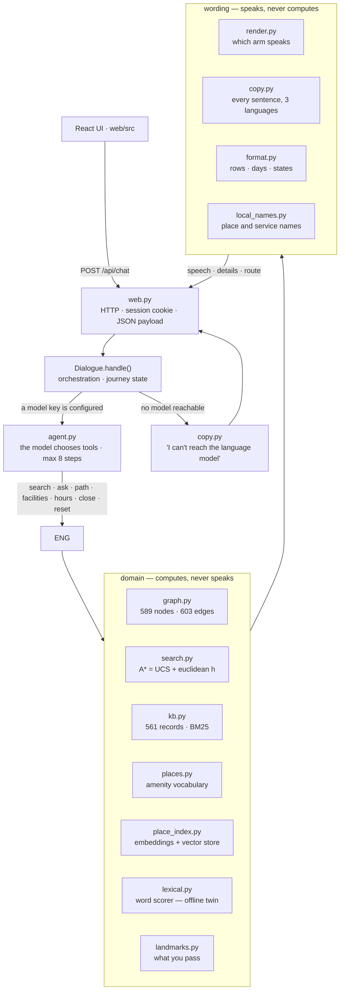
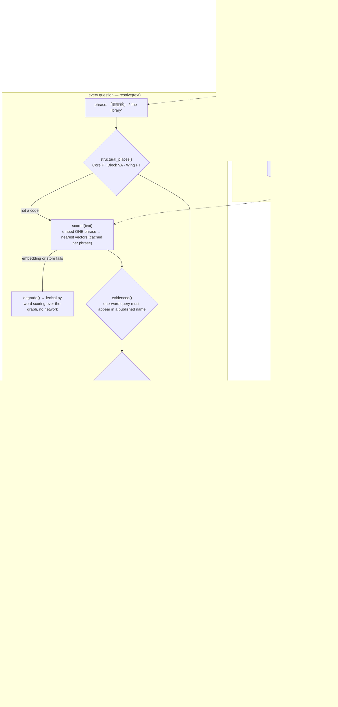

# Architecture

How the app is put together, why it is split that way, and which layer owns which fact.
For installation and usage, see [README.md](../README.md).



| layer | files | size | its one job |
|---|---|---|---|
| door | `web.py` | ~750 | HTTP, sessions, the JSON the browser needs |
| orchestration | `dialogue.py` | ~1,300 | hold the journey, call the engine |
| understanding | `agent.py`, `llm.py`, `nlu.py` | ~750 | turn a message into tool calls |
| domain | `graph`, `search`, `kb`, `hours`, `places`, `place_index`, `lexical`, `landmarks`, `embeddings`, `pinecone` | ~2,370 | compute facts. Never speaks |
| wording | `render`, `copy`, `format`, `local_names`, `narrate`, `replies` | ~950 | say it. Never computes |
| platform | `config`, `speech` | ~360 | settings, local Whisper |
| | | **~6,700** | total application |
| verification | `tests/`, `tools/replay.py` | ~1,050 | prove the above did not change |

**The rule that resolves most confusion: a piece of code belongs to the layer of the question
it must answer.** Where is this place, how far, is it reachable → domain. What did the user
mean → understanding. What is already in the conversation → orchestration. How do I say it in
Cantonese → wording. What JSON does the browser want → door.

## One request, end to end

```
POST /api/chat {"text": "邊度可以食飯？", "lang": "zh-HK"}
  web.py              App.dialogue_for(cookie)         per-browser conversation
  Dialogue.handle     MapAgent.handle                  because a model is configured
  agent               tool call  facilities{item:"food"}
  dialogue            _facilities()
    places            amenity_in_text("food") -> canteen     engine vocabulary
    places            _service_matches()          -> 24 nodes
    place_index       resolve / semantic_places    ids only, no translation
  agent               tool result appended to the messages
  agent               the model writes one or two sentences
  web.chat_payload    render.speech + render.facility_details        wording
  -> {"speech": ..., "text": ..., "facilities": [...]} -> React draws panel and map
```

If `agent.handle()` returns `None` (no key, timeout, dead API), `Dialogue` calls
the model's tools call **four engine methods**
(`_route_reply`, `_facilities`, `_hours`, `_close`). That is why a route planned by the
model and a route planned without one are identical.

## place_index.py in one screen

Its one job: **turn a phrase into the place ids it means.** It is not a parser and it does no
translation — the Chinese is embedded as Chinese and matched against bilingual documents.



Measured, for `圖書館`: cosine ranks **LibCafé 0.592**, AED (Library) 0.566, **Block L 0.550** — the
library is third. The gates, not the embedding, are what pick Block L. The same phrase in
English (`"library"`) is not a problem, because the building's own English name carries the word
(0.70 vs 0.39 in the offline scorer).

| gate | what it prevents |
|---|---|
| `structural_places` | an embedding cannot tell "Block X" from "Block Y" — codes resolve exactly or not at all |
| `evidenced` | a greeting or a verb landing on the nearest building ("Hi" → the HTI department) |
| `cjk_named` | 圖書館 咖啡廳 (the café) outranking 包玉剛圖書館 (the library) |
| band + `NAME_EVIDENCE` | offering four wrong cores as "did you mean" options |
| building over feature | "the library" answered with the defibrillator mounted inside it |
| `degrade()` | a dead vector store taking the whole app with it |

## One front-end: the model

There is one way in. The model reads the message and drives the tools in `agent.py`; there is
no second parser behind it.

| | the model front-end (`agent.py`) |
|---|---|
| reads the sentence | the model |
| decides the steps | the model, via tools |
| calls the engine | `_route_reply` · `_facilities` · `_hours` · `_close` -- the same functions for every turn |
| prose | the model's own sentence |
| when it cannot run | the reply says the model is unreachable; it never guesses |

**What used to be here, and why it went.** Two parsers preceded this: `parse_with_llm()`
(the model returning JSON slots) and `parse_with_grammar()` (49 regexes). The first became
unreachable once the agent landed — `dialogue.handle` always called the grammar with
`client=None`, so it was deleted. The second was deleted deliberately: it was 413 lines of
sentence shapes plus ~30 tests, and it existed to answer when no model was available. With it
goes offline mode, and `nlu.py` is now **100 lines** of shared vocabulary — `Slots`,
`has_cjk`, `asks_for_everything`, `REOPEN` — down from 1,033.

What that cost, recorded once so nobody has to rediscover it: the app needs a model key; a
dead network costs the answer rather than the phrasing; and the Chinese amenity table
(`飯堂 → canteen`) and the closure words went with the grammar, so a Chinese amenity question
now leans on the model naming the English service word, and on the embedding fallback.

The model is given **no vocabulary**: not the 329 place names, not the 52 published services.
Three vocabularies exist (the places; the services; the words people use for what they want)
and only the engine can see them. So the model is given tools, not a catalogue:

```
message ──> model chooses tools ──> engine executes ──> facts go back to the model
            search(name)       real ids, names, buildings, floors
            ask(question)      the turn ends with one question
            path(src, dest)    A* route, metres, minutes, alternatives
            facilities(item)   service search, hours, distances
            hours(place, when) the published timetable, or "not published"
            close(place)       closure, then re-plan
            reset()            forget the journey
```

At most 8 steps per turn (`agent.MAX_STEPS`). A model that loops on `search` cannot turn one
message into an invoice.

## The six vocabulary tables

There are seven tables and three of them are called "labels". They do different jobs:

| table | maps | example | read by |
|---|---|---|---|
| `places.FACILITY_WORDS` | user's word → **capability** | `"lunch" → canteen` | `amenity_in_text` |
| `places.CAPABILITY_LABELS` | capability → **published words** | `canteen → ("catering", "canteen")` | `_service_matches` |
| **`local_names.SERVICE_LABELS`** | published word **or** capability → **Chinese output** | `"Catering Outlets" → 餐飲設施` | `format.place_label`, `render.facility_speech`, the overview |
| `copy.COPY` | message key → **sentence** in 3 languages | `speech.greeting` | `copy.t` |
| `local_names._BUILDING_LABELS` | a name the map never publishes → translation | `Wing QT → QT翼` | `building_name` |
| `format.DAYS` / `kb._DAYS` / `_DAY_NAMES` | day key ↔ weekday | `Tue` | `requested_day`, `timetable` |

Mnemonic: `FACILITY_WORDS` translates *user → engine*;
`CAPABILITY_LABELS` translates *engine → map*; `SERVICE_LABELS` and `copy` translate
*engine → user*.

`local_names.name_parts()` is the one place that knows a published name may use ASCII or
full-width brackets: `"Toilet (Block V)" → ("toilet", "block v")`, `"L座(包玉剛圖書館)" →
("l座", "包玉剛圖書館")`. That split is what stops a match on *where* something is from
outranking a match on *what* it is.

## The layers, and what happens without a key

Each layer has a deterministic twin, so a missing key costs coverage, never the application.

| layer | primary | fallback | without it |
|---|---|---|---|
| conversation | tool-calling assistant (`agent.py`) | **none** | the reply says the model is unreachable; it never guesses |
| name identity | embeddings + vector index (`place_index.py`) | built-in word scorer (`lexical.py`) | exact-ish names still resolve; no paraphrases |
| facts | BM25 over 561 campus-map records (`kb.py`) | — always local | — |
| routing | A* and UCS over the walkway graph (`search.py`) | — always local | — |
| wording | the assistant's own sentence | `copy.py` + `render.py` | plainer sentences |

The server prints the live path at startup and `GET /api/status` exposes it.

## Memory: three stores, three lifetimes

| store | holds | lives in | cleared by |
|---|---|---|---|
| `SessionState` | origin, destination, stops, closures, stair preference, last list | the server, one per browser cookie (32 max, oldest dropped) | "Clear", `reset`, eviction |
| parser history | the whole conversation (400 chars per message) | the same server-side object, append-only | the same |
| transcript | the visible conversation | that browser's `localStorage`, versioned | the Clear button, or the error panel |

The parser sees the whole conversation, and it is *not* the memory: the journey travels as a
one-line system message rebuilt from `SessionState` every turn ("CURRENT JOURNEY … origin
Block V; destination the library; stops in order: Core P"). A fact cannot be garbled the way
prose can. Resetting clears the state **and** the history — clearing only the state once left
the parser able to read a conversation the user had erased.

Tool results are not replayed across turns: each turn is a fresh message list of the system
prompt, the digest and the history. That is why an answer has to *name* the candidates it
offered — the sentence is the only record of them.

## Guards: code, not prompt text

- **A number must have been computed.** `narrate.grounded_numbers()` derives the allowed set
  from the payload the model was given, and discards any sentence with a figure outside it.
  Digits inside a place name ("7-Eleven") count as the name.
- **The user's location must be known to claim it.** `narrate.claims_unknown_location()`
  refuses "right where you are" when nobody said where that is.
- **The language must match the request.** `narrate.in_language()` refuses a Chinese question
  answered with an English sentence, and vice versa.
- **A name has to be in the words.** Dense matching always returns neighbours, so a one-word
  query must appear in a published name (`PlaceIndex.NAME_EVIDENCE`, `place_index.evidenced`).
  Building codes resolve exactly or not at all: "Core Y" answers *"did you mean Block Y?"*.
- **Chinese names are head-final inside a segment** (`place_index.cjk_named`): 圖書館 is the
  end of `L座(包玉剛圖書館)`, while `圖書館咖啡廳` is the café. Cosine alone ranks the café
  first (0.592) over the library (0.550).
- **A closure must have been said**, in either script (`nlu._CLOSED_SAID`), and must name a
  place the resolver knows. On the agent path this is the model's decision to call
  `close(place)` at all, and `dialogue._close` still refuses a name it cannot resolve.

All of these run on the sentence the assistant is about to speak (`agent._refusals`), against
the payloads the tools returned. A sentence that fails is **replaced by the engine's own
sentence** -- `render.speech(reply, …)`, the same words the details panel would show -- so a
refusal costs the phrasing, never the answer. When the model answered without calling a tool
there is nothing to substitute: the sentence is then kept but marked *not narrated*, with the
reason in `reply.notes`, so the transcript says what happened.

There used to be a fourth layer here: a *narrator*, a second model call that re-phrased a
`Facts` object. It was removed for the same reason `parse_with_llm` was -- the assistant now
writes its own sentence inside the tool loop, so the narrator was unreachable, and asking the
same model about its own answer is not a design, it is an extra bill.

## Verification

| net | what it proves | how |
|---|---|---|
| `pytest tests -q` | 78 tests, no network, no keys, no server | unit |
| `tests/test_engine.py` | the deterministic net: routes, stops, closures, facilities, hours and the journey digest, all measured by the engine | unit, no model |
| `tools/replay.py --live --diff golden.json` | 25 fixed prompts × 3 languages against a real model: whole-turn diffs | golden diff, needs a key |
| facility net | 26 facility questions × 3 languages: summary and detail panel unchanged | golden diff |

`replay.py` pins the clock (`CAMPUS_NAV_NOW`, see `kb.clock`): answers say "open now", and a
canteen crossing 10:30 between two runs once produced a diff no code change had caused.

## Layout

| Path | What |
|---|---|
| `campus_nav/` | the application (see the layer table above) |
| `campus_nav/agent.py` | the tool-calling front-end: 7 tools, max 8 steps |
| `campus_nav/nlu.py` | the shared vocabulary: `Slots`, `has_cjk`, `asks_for_everything`, `REOPEN` (100 lines) |
| `campus_nav/copy.py` | every sentence the app says, keyed by language |
| `campus_nav/narrate.py` | the three checks a sentence must pass before it is spoken |
| `campus_nav/format.py` | shapes with no prose: which rows, which day, what state |
| `campus_nav/hours.py` | quote the published table, list the candidates, or say there is none |
| `tools/build.py` | build the graph, embed the place names |
| `tools/replay.py` | whole-turn diffs against a live model (`--live` only) |
| `tools/setup_voice.py` | install whisper.cpp + the multilingual model |
| `web/` | React 18 + TypeScript + Tailwind, built by Vite into `campus_nav/static/` |
| `data/authored/` | the GeoJSON you draw and edit |
| `data/raw_data/` | the scraped JSON the knowledge base reads |
| `data/processed_data/campus_graph.json` | **generated** — the only file the app reads at runtime |

The graph is read **once at startup**: after `python tools/build.py graph` you must restart
the server, or the browser keeps being served the graph the old process holds. The server
refuses a port that is already listening (`web._Server` turns `SO_REUSEADDR` off), because
Windows otherwise lets a second process bind a live port and an old copy answers some requests.

## Tests, and what each file pins

| File | What it pins |
|---|---|
| `test_guards.py` | the three sentence checks: language, grounded numbers, location claims |
| `test_agent.py` | the tool front-end: search returns real ids, `path` refuses the rest, `ask` ends the turn, a looping model is stopped |
| `test_engine.py` | the engine driven as the tools drive it: walk time, route receipt, stops, the journey digest, closures and re-opening, facility counts, quoted-or-declined hours, day reading, and the no-model reply |
| `test_place_index.py` | resolution in both modes: the name-evidence gate, one answer per name, the lexical band |
| `test_render.py` | the catalogue and renderer: every message in every language, unknown key is a bug |
| `test_cjk_names.py` | Chinese name evidence: head-final matching inside a bracket, place before facility |
| `test_landmarks.py` | landmarks along a route: the 20 m band, order, cap, buildings only |
| `test_off_network.py` | published-but-unreachable places stay in the graph and are refused in words |
| `test_drift.py` | tables that must agree: services ↔ labels, days, copy languages, payload numbers |

## Known limitations

- **Opening hours are joined by title.** The published tables cover 33 of 561 records, matched
  by the name both sources print (326 of 329 places). The three that no published title matches
  are unreachable, and a scrape that stopped quoting the map's id is not repairable here.
- **No indoor geometry.** A facility inside a building is reached through the building; the
  reply gives the floor, not a corridor. Lifts and internal stairs are not modelled.
- **The walkway network has gaps.** Footways passing metres apart without a shared node force
  detours; a place more than 120 m from any walkway is attached by one straight connector.
- **There is no offline mode.** The grammar parser was removed deliberately, so a missing key
  or a dead network costs the answer: the reply says the model is unreachable. The vector index
  still has its offline twin (`lexical.py`), but that only affects how well a *name* resolves,
  not whether the sentence is understood at all.
- **Two things went with the grammar and now depend on the model**: the Chinese amenity table
  (`飯堂 → canteen`) and the closure words (`封咗`, `關閉`). A Chinese amenity question therefore
  relies on the model naming the English service word, and falls back to the embedding search
  when it does not.
- **Alternatives on a stop journey can be a metre apart** — they differ in steps and side of
  building, which the reply prints.
- **A vague wish returns closest matches, not a category.** "Somewhere quiet to study" can
  offer a bookshop before a plaza, and the reply says "closest places for …" rather than
  pretending otherwise.
- **Some published places are not on the walkway network** (halls, West Kowloon, a few
  schools). They stay in the graph, drawn with a dashed ring, and are refused in words.
- **Distances are modelled**: edge length along the drawn walkway plus a straight connector,
  and walk time is that distance divided by 1.25 m/s — an easy pace, not a personal one.
- **A relative place reference needs the thing to still be findable.** Tool results are not
  replayed, so "the seventh one" only resolves if the answer named it.
